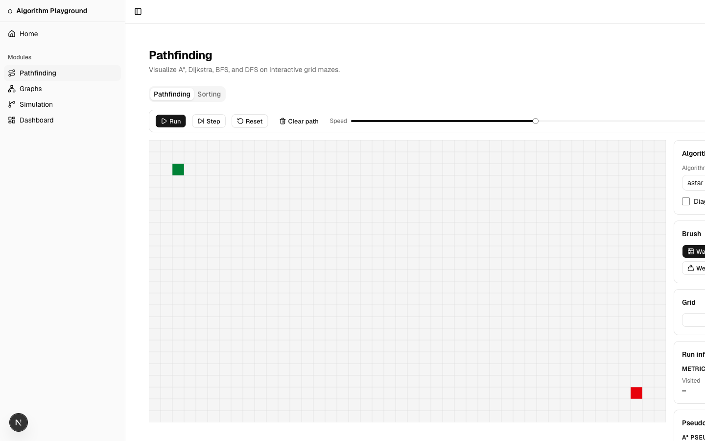
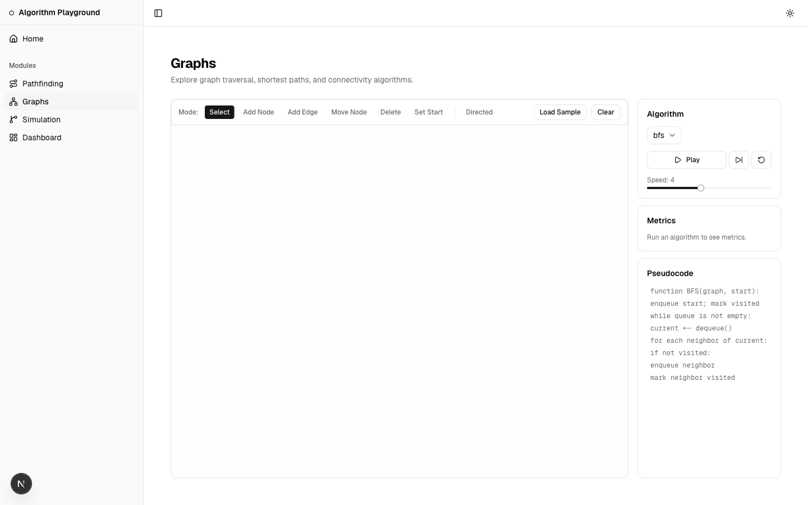
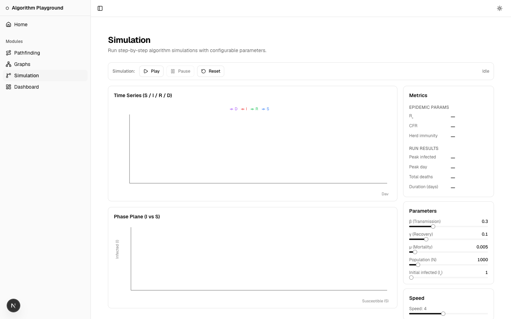
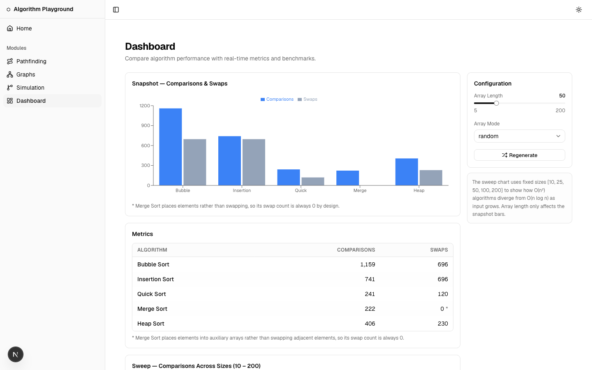

# Algorithm Systems Playground

An interactive portfolio of classic computer-science algorithms — each implemented from scratch and rendered in real time. The playground demonstrates pathfinding, graph traversal, discrete simulation, and performance comparison through live, configurable visualizations.

No algorithm logic is imported from external libraries. Every core implementation (A\*, Dijkstra, BFS, DFS, graph traversal, simulation engine) is written from scratch inside `src/lib/` to keep the learning signal clear.

## Module table

| Module | Route | Status | What it shows |
|--------|-------|--------|---------------|
| Pathfinding | `/pathfinding` | ✅ Available | A\*, Dijkstra, BFS, DFS on interactive grid mazes |
| Graphs | `/graphs` | ✅ Available | Graph traversal, shortest paths, connectivity algorithms |
| Simulation | `/simulation` | ✅ Available | Step-by-step algorithm simulations with configurable parameters |
| Dashboard | `/dashboard` | ✅ Available | Algorithm performance comparisons with real-time metrics |

## Screenshots

| Pathfinding | Graphs |
|-------------|--------|
|  |  |

| Simulation | Dashboard |
|------------|-----------|
|  |  |

The [home page](public/screenshots/home.png) links into each module.

## Stack

| Layer | Choice |
|-------|--------|
| Framework | Next.js 16 (App Router, React 19) |
| Styling | Tailwind CSS 4 — semantic tokens in `globals.css` |
| UI primitives | shadcn/ui (themed to the project token system) |
| Icons | lucide-react |
| Theme switching | next-themes (`defaultTheme="system"`) |
| Testing | Vitest + Testing Library + jsdom |
| Package manager | pnpm |

## Architecture principles

**Generic primitives vs. domain components**
Generic UI primitives (Button, Card, Tabs, Slider, Tooltip, Select, Sidebar) are shadcn/ui components themed through semantic CSS custom properties. Domain-specific components and all algorithm/simulation logic are implemented from scratch — nothing in `src/lib/` is imported from an algorithm or visualization library.

**Pure lib/ logic**
`src/lib/` contains only pure functions and typed interfaces. No React, no DOM, no side effects at the lib layer. Components in `src/components/` consume lib output; lib does not know about UI.

**Separation of logic and UI**
Each module follows a strict boundary: the algorithm runs in a pure function in `src/lib/{module}/`; the visualization component in `src/app/{module}/` consumes the result and handles rendering. Testing targets the pure layer independently.

**URL-serializable state**
All module configuration (algorithm choice, grid size, speed, etc.) is encoded in query parameters via a typed `StateCodec<T>` interface (`src/lib/url-state.ts`). Any session can be reproduced by sharing a URL. See `docs/adr/url-state.md` for the full encoding convention.

**Server components by default**
Layout, pages, and data-display components are React Server Components. `"use client"` is added only where interactivity is strictly required (theme toggle, sidebar collapse, algorithm controls).

## How to run

```bash
# Install dependencies
pnpm install

# Start dev server
pnpm dev

# Run tests (Vitest)
pnpm test

# Watch mode
pnpm test:watch

# Production build
pnpm build
```

## Test status

Unit and component tests run with `pnpm test` (Vitest) and are colocated next to source files using `*.test.ts` / `*.test.tsx`. End-to-end and accessibility tests run with `pnpm test:e2e` (Playwright + `@axe-core/playwright`) from `tests/e2e/`, covering all five routes in light and dark themes; they also run in CI on every pull request.

## Project phases

| Phase | Scope |
|-------|-------|
| 0 — Foundations | Shell, tokens, layout, test harness (this phase) |
| 1 — Pathfinding | A\*, Dijkstra, BFS, DFS on a canvas grid |
| 2 — Graphs | Graph data structures and traversal algorithms |
| 3 — Simulation | Discrete event simulation with step control |
| 4 — Dashboard | Cross-algorithm benchmarks and metrics |
| 5 — Polish | WCAG accessibility audit (skip link, single landmark, contrast, reduced motion), View Transitions, E2E + axe in CI, screenshots — ✅ complete |
